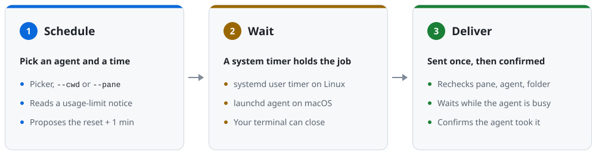

# schedule-send

[](https://github.com/dj-skn/schedule-send/actions/workflows/ci.yml)
[](https://github.com/dj-skn/schedule-send/releases/latest)
[](LICENSE)
[](go.mod)
[](#install)
[](https://herdr.dev/plugins/)

Schedule a message into a running [Herdr](https://herdr.dev) agent, and have
it pick up where it left off the minute its usage limit resets.


`schedule-send` reads the usage-limit notice on a Claude or Codex agent's
screen and schedules `resume` for a minute after the reset. It can also send
any message, a file, or key presses to any agent or terminal pane at a time
you choose. Each job is a system timer, so the terminal you scheduled it from
can close, and the target is checked again before anything is sent.

## Install

macOS or Linux, with Homebrew:

```sh
brew install dj-skn/tap/schedule-send
```

Linux, with the install script, which checks the download and puts the
program in `~/.local/bin`:

```sh
curl -fsSL https://raw.githubusercontent.com/dj-skn/schedule-send/main/install.sh | sh
```

As a Herdr plugin, which adds an action that schedules a send to the focused
agent:

```sh
herdr plugin install dj-skn/schedule-send
```

On Linux the plugin runs the install script if the program is missing. On
macOS, install the program with Homebrew first.

It needs [Herdr](https://github.com/herdrdev/herdr); the plugin needs Herdr
0.9.3 or newer. Run either install command again to upgrade. On Linux, timers
outlive a logout only with
[user lingering](docs/usage.md#requirements-and-the-installed-path) turned on.

## Quick start

Resume an agent that hit its limit. Run it with no options and it asks three
things, each with Enter for the usual answer: which agent, with the limited
ones first; what to send, `resume` by default; and when, a minute after the
reset, or type another time, such as `16:30` or `+30 min`, and confirm it
with Enter.

```sh
schedule-send
```

Send a message at a time. A directory, a pane, or an agent kind picks the
target, and with one match there is nothing to choose:

```sh
schedule-send --cwd ~/projects/website --at 18:30 --message 'run the e2e suite'
```


A few more:

```sh
schedule-send --targets                           # agents and panes you can target
schedule-send --pane wA:p1 --auto                 # take the detected reset time without asking
schedule-send --pane wA:p3 --at 9:00 --keys ctrl+c
schedule-send --pane wA:p2 --at '+1 hour' --message-file prompt.md
schedule-send --list                              # scheduled sends
schedule-send --cancel 20261015-183000-wBp1
```

Add `--dry-run` to preview a send without scheduling it, and `--json` for
output a script can read. The [usage reference](docs/usage.md) has every
option.

## In Herdr

With the plugin installed, bind its action to a key in Herdr's
`config.toml`. Any free key works; this one follows Herdr's own examples:

```toml
[[keys.command]]
key = "prefix+alt+s"
type = "plugin_action"
command = "dj-skn.schedule-send.schedule"
description = "schedule a send"
```

Focus an agent or a shell pane and press it. An overlay opens over it and
asks what to send and when, proposing a minute after the reset if a limit
holds the agent, then shows the receipt until you press Enter.


Options for every send from the plugin, such as `--dry-run`, go in an
[`args` file](docs/usage.md#the-herdr-plugin).

## How it works

<picture>
  <source media="(prefers-color-scheme: dark)" srcset="docs/media/how-it-works-dark.svg">
  
</picture>

Scheduling writes the job to `~/.local/state/herdr-send` and hands it to a
systemd user timer on Linux or a launchd agent on macOS. At the time, the
timer runs `schedule-send` again. It checks that the pane still holds the same
agent in the same directory, waits up to 15 minutes while the agent is busy,
then sends the text once through Herdr and confirms the agent took it. If the
prompt is left sitting in the agent's input box it may press Enter again, but
it never sends the text twice.

A job missed while the machine was off is skipped, unless it was scheduled
with `--persistent`. On a Mac, a job whose time passes during sleep is sent on
wake.

## Documentation

- [Usage reference](docs/usage.md): targets, times, delivery, managing jobs,
  JSON output, the plugin, and where files live.
- [Changelog](CHANGELOG.md)
- [Contributing](CONTRIBUTING.md): building from source, the checks, and
  releasing.
- [Security policy](SECURITY.md)

## License

[MIT](LICENSE)
