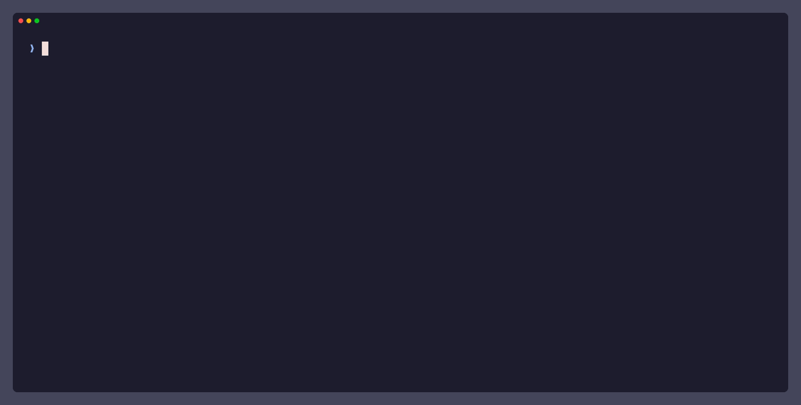
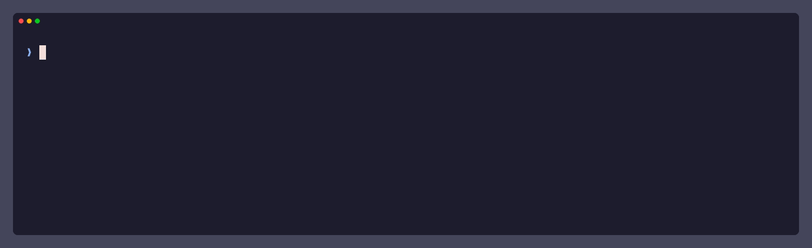
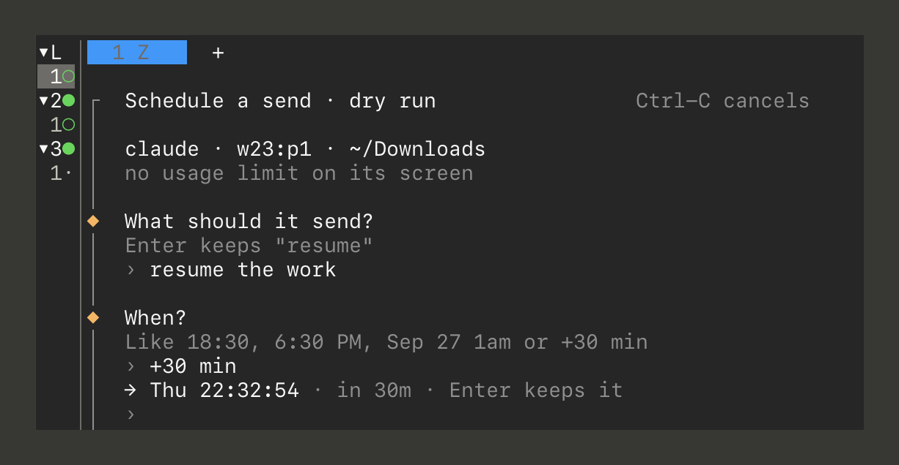

<h1 align="center">schedule-send</h1>

<p align="center">
  <a href="#install">install</a> · <a href="#quick-start">quick start</a> · <a href="#herdr-plugin">plugin</a> · <a href="docs/usage.md">docs</a>
</p>

<p align="center">
  <a href="https://github.com/dj-skn/schedule-send/actions/workflows/ci.yml"></a>
  <a href="https://github.com/dj-skn/schedule-send/releases/latest"></a>
  <a href="LICENSE"></a>
  <a href="go.mod"></a>
  <a href="#install"></a>
  <a href="https://herdr.dev/plugins/"></a>
</p>

**Scheduled messages for your [Herdr](https://herdr.dev) agents.** At a time
you choose, or a minute after a usage limit resets.



- **Resume after a usage limit** — reads the reset time off a Claude Code or
  Codex screen, so you don't have to.
  [usage limits →](docs/usage.md#resume-after-a-usage-limit)
- **Any message, at any time** — a prompt, a file, or key presses, to an agent
  or a shell pane, at `Sep 28 1am` or `+1h`.
  [times →](docs/usage.md#times-and-payloads)
- **Close the terminal** — a systemd user timer on Linux, or launchd on macOS,
  starts each job, so nothing is left running.
- **The agent you chose, or nothing** — at send time, it checks that the pane
  still holds the same agent in the same folder.
- **Waits while the agent works** — up to 15 minutes for it to finish, then
  sends and confirms the agent took the text.
  [delivery →](docs/usage.md#delivery-and-failures)
- **Tells you when it can't** — any failure raises a Herdr notification,
  unless you pass `--quiet`.
- **One key in Herdr** — the [plugin](#herdr-plugin) schedules from an overlay
  on the focused pane.
- **Built for scripts** — `--dry-run` previews a job, and `--json` gives output
  a script can read.

It never types your text twice, and never answers a dialog on its own. A job
missed while the machine was off is skipped, unless you scheduled it with
`--persistent`. [missed jobs →](docs/usage.md#manage-jobs-and-missed-runs)

## Install

You need Herdr on Linux or macOS. With Homebrew, on either:

```sh
brew install dj-skn/tap/schedule-send
```

On Linux without Homebrew, the install script checks the download's SHA-256
and installs to `~/.local/bin`:

```sh
curl -fsSL https://raw.githubusercontent.com/dj-skn/schedule-send/main/install.sh | sh
```

To upgrade, run the same command again. On Linux, jobs fire only while you are
logged in, unless
[user lingering](docs/usage.md#requirements-and-the-installed-path) is on.
You can also install it as a [Herdr plugin](#herdr-plugin).

## Quick start

### Resume after a usage limit

Run it with no options:

```sh
schedule-send
```

It asks which agent, what to send, and when. For an agent at its usage limit,
Enter accepts each proposal. Otherwise, type a time, such as `18:30` or
`+30 min`.

### Send a message at a set time



Choose the agent by its working directory:

```sh
schedule-send --cwd ~/projects/website --at 18:30 --message 'run the e2e suite'
```

### More examples

```sh
# List agents and panes, with their IDs
schedule-send --targets

# Take the proposal without asking
schedule-send --pane wA:p1 --auto

# Press Ctrl-C in a pane at 9:00
schedule-send --pane wA:p3 --at 9:00 --keys ctrl+c

# Send a file as one prompt, an hour from now
schedule-send --pane wA:p2 --at +1h --message-file plan.md

# List scheduled jobs, then cancel one by its ID
schedule-send --list
schedule-send --cancel 20261015-183000-wBp1
```

The [usage reference](docs/usage.md) lists every option.

## Herdr plugin



Install it with Herdr 0.9.3 or newer:

```sh
herdr plugin install dj-skn/schedule-send
```

On Linux, the plugin installs the program if it is missing. On macOS, run the
Homebrew command first.

Bind the plugin's action to any free key in Herdr's `config.toml`, for
example:

```toml
[[keys.command]]
key = "prefix+alt+s"
type = "plugin_action"
command = "dj-skn.schedule-send.schedule"
description = "schedule a send"
```

Focus an agent or a shell pane and press the key. An overlay asks what to send
and when, with the same proposals as a terminal run.

## Documentation

- [Usage reference](docs/usage.md): targets, times, delivery, managing jobs,
  output for scripts, the plugin, and where files live.
- [Changelog](CHANGELOG.md)
- [Contributing](CONTRIBUTING.md): building from source, the checks, and
  releasing.
- [Security policy](SECURITY.md)

## License

[MIT](LICENSE)
